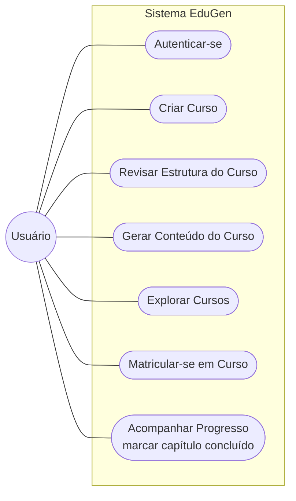

# Casos de Uso – EduGen

## Diagrama

O diagrama mostra apenas as associações entre o usuário e os casos de uso. A ordem entre criar o curso, revisar a estrutura e gerar o conteúdo é uma **sequência do fluxo**, e não uma inclusão de comportamento. Por isso ela aparece nas descrições abaixo e no [fluxo de geração](04-fluxo-de-geracao.md), e não como relações «include».

## Descrições

### UC1 – Autenticar-se (RF01)
- **Ator:** Usuário
- **Fluxo principal:**
  1. O usuário acessa a página de login ou de cadastro.
  2. O provedor de identidade autentica o usuário.
  3. O sistema registra o usuário no banco, se ainda não existir.
- **Pós-condição:** sessão ativa; as rotas protegidas ficam acessíveis.

### UC2 – Criar Curso (RF02, RF03, RF04)
- **Ator:** Usuário (autor)
- **Pré-condição:** usuário autenticado.
- **Fluxo principal:**
  1. O usuário preenche tema, descrição, número de capítulos, nível, categoria e opção de vídeos.
  2. O sistema valida o formulário (RNF06).
  3. O sistema solicita à IA a estrutura do curso (capítulos, durações e tópicos) e um prompt visual para a capa.
  4. O sistema solicita a imagem de capa ao modelo de imagens.
  5. O curso é salvo, e o usuário é levado à tela de revisão.
- **Fluxo alternativo:** se a capa falhar, o curso é salvo sem imagem e a interface mostra um ícone (RN05).

### UC3 – Revisar Estrutura do Curso (RF05)
- **Ator:** Usuário (autor)
- **Pré-condição:** curso criado e conteúdo ainda não gerado.
- **Fluxo principal:**
  1. O sistema exibe a capa, o nível e a lista de capítulos e tópicos.
  2. O autor pode editar o nome, a duração e os tópicos de cada capítulo e salvar.
- **Regras:** RN01, RN02, RN03.
- **Observação:** esta revisão confere a **estrutura**. Ela não substitui a verificação factual e pedagógica dos textos gerados depois.

### UC4 – Gerar Conteúdo do Curso (RF06, RF07)
- **Ator:** Usuário (autor)
- **Pré-condição:** estrutura revisada.
- **Fluxo principal:**
  1. O autor solicita a geração do conteúdo.
  2. Para cada capítulo, em paralelo, o sistema solicita o texto à IA e, se a opção de vídeos estiver marcada, busca vídeos no YouTube.
  3. O conteúdo é salvo, e o curso fica disponível.
- **Fluxo alternativo:** se a busca de vídeos falhar, o capítulo é salvo sem vídeos (RNF03).

### UC5 – Explorar Cursos (RF10)
- **Ator:** Usuário
- **Fluxo principal:** o usuário vê a lista de cursos disponíveis, incluindo os de outros autores.

### UC6 – Matricular-se em Curso (RF08)
- **Ator:** Usuário
- **Fluxo principal:**
  1. O usuário escolhe um curso e confirma a matrícula.
  2. O curso passa a aparecer em "Meu aprendizado".

### UC7 – Acompanhar Progresso (RF09)
- **Ator:** Usuário matriculado
- **Fluxo principal:**
  1. O usuário abre o leitor e navega pelos capítulos.
  2. O usuário marca ou desmarca capítulos como concluídos.
  3. O sistema recalcula o progresso exibido.
- **Regra:** RN06. O progresso é declarado pelo usuário e não verifica domínio do conteúdo.
