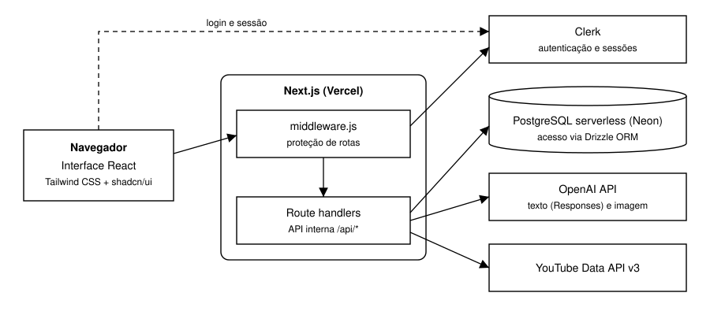
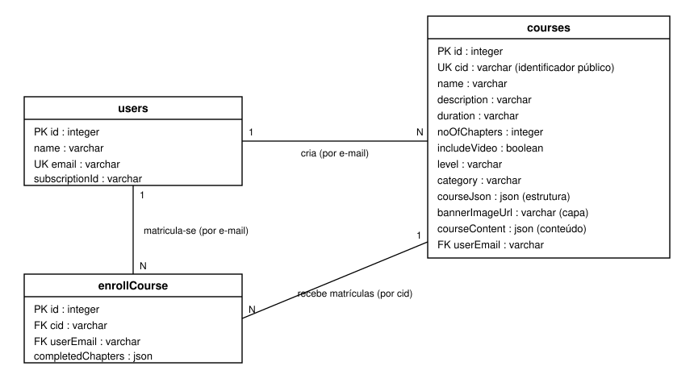

# Arquitetura e Modelo de Dados – EduGen

## 1. Visão geral

O EduGen é uma aplicação web *full-stack* em Next.js com App Router. A interface em React e a API interna (*route handlers*) ficam no mesmo projeto. A aplicação está implantada na Vercel.

*Arquitetura do EduGen: interface, API interna e serviços externos. Fonte: elaboração própria.*

## 2. Tecnologias

Versões instaladas conforme o `package-lock.json`:

| Camada | Tecnologia | Versão |
|---|---|---|
| Framework | Next.js (App Router) | 16.3 |
| Interface | React | 18.3 |
| Estilo | Tailwind CSS + Radix UI via shadcn/ui | 4 |
| Banco de dados | PostgreSQL serverless (Neon), `@neondatabase/serverless` | 1.1 |
| ORM e migrações | Drizzle ORM / Drizzle Kit | 0.45 |
| Autenticação | Clerk, `@clerk/nextjs` | 6.39 |
| IA (texto) | OpenAI API Responses, modelo padrão `gpt-4o` | – |
| IA (imagem) | OpenAI Images, modelo padrão `gpt-image-1-mini` | – |
| Vídeos | YouTube Data API v3 | – |
| Linguagem | JavaScript | – |
| Hospedagem | Vercel | – |

Os modelos podem ser trocados pelas variáveis de ambiente `OPENAI_TEXT_MODEL` e `OPENAI_IMAGE_MODEL`.

### Variáveis de ambiente

| Variável | Uso |
|---|---|
| `OPENAI_API_KEY` | Chave da OpenAI (obrigatória) |
| `OPENAI_TEXT_MODEL` | Modelo de texto (padrão `gpt-4o`) |
| `OPENAI_IMAGE_MODEL` | Modelo de imagem (padrão `gpt-image-1-mini`) |
| `YOUTUBE_API_KEY` | Chave da YouTube Data API; sem ela, os capítulos ficam sem vídeos |
| Variáveis do Clerk e do Neon | Autenticação e conexão com o banco |

## 3. Rotas da API

| Rota | Método | Função |
|---|---|---|
| `/api/user` | POST | Registra o usuário autenticado no banco, se ainda não existir |
| `/api/generate-course-layout` | POST | Etapa 1: gera a estrutura e a capa e salva o curso |
| `/api/courses` | GET | Lista cursos (do autor, para exploração ou um curso específico) |
| `/api/courses` | PATCH | Edita um capítulo da estrutura (somente o autor e somente antes da geração do conteúdo) |
| `/api/generate-course-content` | POST | Etapa 2: gera o conteúdo dos capítulos e busca vídeos |
| `/api/enroll-course` | POST | Matricula o usuário em um curso |
| `/api/enroll-course` | GET | Lista os cursos em que o usuário está matriculado |
| `/api/enroll-course` | PUT | Atualiza os capítulos concluídos |

## 4. Telas principais

| Tela | Caminho | Função |
|---|---|---|
| Login / cadastro | `/sign-in`, `/sign-up` | Autenticação (RF01) |
| Painel | `/workspace` | Cursos criados e criação de novo curso (RF02, RF10) |
| Revisão da estrutura | `/workspace/edit-course/[courseId]` | Revisar, editar e gerar o conteúdo (RF05, RF06) |
| Explorar | `/workspace/explore` | Cursos disponíveis e matrícula (RF08, RF10) |
| Meu aprendizado | `/workspace/my-learning` | Cursos matriculados (RF10) |
| Leitor do curso | `/course/[courseId]` | Leitura dos capítulos e marcação de progresso (RF09) |

## 5. Modelo de dados

*Modelo de dados do EduGen (PK: chave primária; UK: valor único; FK: chave estrangeira). Fonte: elaboração própria.*

| Tabela | Principais campos | Relacionamentos |
|---|---|---|
| `users` | Nome, e-mail (único) | Referenciada por `courses` e `enrollCourse` (por e-mail) |
| `courses` | Identificador público, nome, descrição, nível, categoria, estrutura gerada, capa, conteúdo gerado | Autoria vinculada a `users` (por e-mail) |
| `enrollCourse` | Capítulos concluídos | Vinculada a `users` (por e-mail) e a `courses` (por identificador público) |

O campo `subscriptionId` e a página `/workspace/billing` vêm de uma funcionalidade de cobrança que está **desativada** nesta versão.

## 6. Decisão de arquitetura: geração direta

A revisão da literatura identificou abordagens como arquiteturas multiagente, grafos de conhecimento e RAG. O EduGen usa **geração direta**, com instruções *zero-shot* e formato de resposta controlado por *Structured Outputs* (esquema JSON estrito). Essa escolha tem menor complexidade de implementação e atende aos requisitos funcionais sem exigir infraestrutura de recuperação de informação nem múltiplos agentes. Ela não foi comparada experimentalmente com as alternativas, e não se afirma que seja superior a elas.
