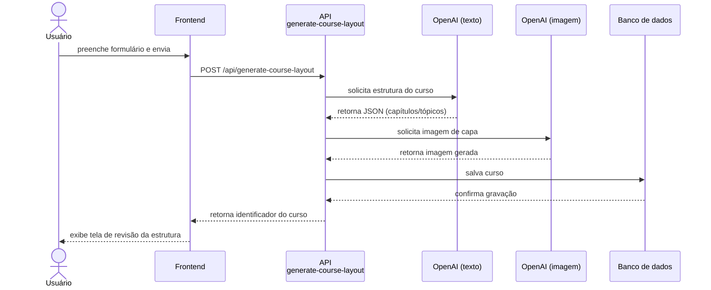
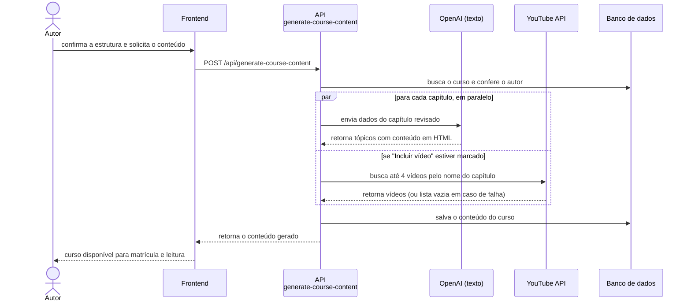

# Fluxo de Geração e Prompts – EduGen

## 1. Geração em duas etapas

A criação automatizada é dividida em duas etapas:
1. A IA gera a **estrutura** do curso a partir dos parâmetros do formulário.
2. Depois que o autor revisa a estrutura, a IA gera o **conteúdo** de cada capítulo.

Com essa separação, o autor confere e edita capítulos e tópicos antes de solicitar os textos.

### Etapa 1 – Estrutura e capa



### Etapa 2 – Conteúdo dos capítulos



## 2. Configuração dos modelos

| Item | Configuração |
|---|---|
| Modelo de texto | `gpt-4o` (padrão; variável `OPENAI_TEXT_MODEL`) |
| Modelo de imagem | `gpt-image-1-mini` (padrão; variável `OPENAI_IMAGE_MODEL`), 1536×1024, qualidade baixa, formato WebP |
| API de texto | OpenAI Responses, com `text.format` do tipo `json_schema` e `strict: true` |
| Estratégia de instrução | *Zero-shot*: instrução fixa, dados enviados em JSON, sem exemplos de pares de entrada e resposta |
| Não utilizados | *Few-shot*, RAG e *fine-tuning* |
| Temperatura / limite de tokens | Não definidos explicitamente (valores padrão da API) |

O *zero-shot* e os *Structured Outputs* têm papéis diferentes:
- o **prompt** orienta o conteúdo, o idioma e as regras de produção;
- o **esquema JSON** restringe os campos e os tipos da resposta.

O esquema garante um formato processável. Ele não garante correção factual nem progressão pedagógica.

## 3. Prompt da Etapa 1 – Estruturar o curso

**Entrada** (serializada em JSON): tema, descrição, número de capítulos, nível, categoria e preferência por vídeo.

**Instrução fixa:**

```text
Crie a estrutura de um curso conforme os dados fornecidos pelo usuário.
Responda no mesmo idioma do tema informado. Respeite a quantidade de capítulos, o nível e a preferência por vídeo.
Cada capítulo deve ter duração realista e uma lista objetiva de tópicos.
chapterName deve conter apenas o título do capítulo, sem prefixos como "Capítulo 1:", pois a interface já numera os capítulos.
O número noOfChapters deve ser igual ao tamanho de chapters.
bannerImagePrompt deve ser um prompt visual detalhado, sem texto na imagem, para uma ilustração 3D moderna, educacional e em formato paisagem.
```

**Esquema de saída:**

```json
{
  "course": {
    "name": "string",
    "description": "string",
    "category": "string",
    "level": "string",
    "includeVideo": "boolean",
    "noOfChapters": "integer",
    "bannerImagePrompt": "string",
    "chapters": [
      { "chapterName": "string", "duration": "string", "topics": ["string"] }
    ]
  }
}
```

O `bannerImagePrompt` gerado é enviado ao modelo de imagens para criar a capa. A exigência de "duração realista" é uma instrução ao modelo, e não um resultado pedagogicamente validado.

## 4. Prompt da Etapa 2 – Redigir os capítulos

**Entrada:** os dados de um capítulo já revisado (nome, duração e tópicos). Os demais campos do formulário, incluindo nível e descrição, **não** são reenviados. A influência deles ocorre por meio da estrutura gerada na Etapa 1.

**Instrução fixa:**

```text
Produza uma aula completa para o capítulo fornecido.
Preserve exatamente o nome, a duração e todos os tópicos recebidos, na mesma ordem e idioma.
Para cada tópico, escreva conteúdo didático e correto em HTML semântico.
Use somente elementos de conteúdo como h2, h3, p, ul, ol, li, strong, em, table, thead, tbody, tr, th, td, pre e code.
Não inclua html, head, body, scripts, estilos inline ou Markdown.
```

**Esquema de saída:**

```json
{
  "chapterName": "string",
  "duration": "string",
  "topics": [
    { "topic": "string", "content": "string (HTML)" }
  ]
}
```

A restrição de elementos HTML no prompt **não** equivale a sanitizar a saída, e a exigência de conteúdo "correto" não é uma validação factual. O HTML é exibido no leitor sem sanitização (ver [limitações](01-requisitos.md#7-limitações-conhecidas)).

## 5. Exemplo ilustrativo

O exemplo abaixo é uma **reconstrução ilustrativa** dos campos exibidos na interface, e não um registro das sessões de avaliação.

- **Formulário:** fundamentos de bancos de dados relacionais; público iniciante; quatro capítulos; categoria Banco de Dados/Programação; vídeos desativados.
- **Estrutura gerada:**
  1. Introdução aos Bancos de Dados Relacionais
  2. Estrutura de um Banco de Dados Relacional
  3. Conceitos de Normalização
  4. Introdução ao SQL
- **Entrada da Etapa 2 (capítulo 2):**

```json
{
  "chapterName": "Estrutura de um Banco de Dados Relacional",
  "duration": "45 minutos",
  "topics": ["Tabelas e registros", "Colunas e tipos de dados", "Chaves primárias e estrangeiras"]
}
```

O exemplo mostra o fluxo e o formato do artefato. Ele não avalia a correção nem a eficácia pedagógica do conteúdo.
