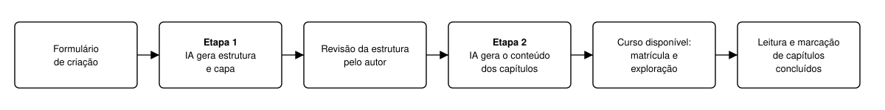

# Documentação do EduGen

O EduGen é um sistema web que usa IA Generativa para criar trilhas de aprendizagem. A partir de poucos parâmetros (tema, descrição, número de capítulos, nível, categoria e opção de vídeos), o sistema gera a estrutura de um curso. O autor revisa essa estrutura, e só então o conteúdo de cada capítulo é gerado. Depois de pronto, o curso pode receber matrículas e ser lido com acompanhamento de conclusão dos capítulos.

Esta documentação acompanha o Trabalho de Conclusão de Curso *EduGen: Um Sistema Web para Geração Automatizada de Trilhas de Aprendizagem com IA Generativa* (Sistemas de Informação, UNIFEI, 2026).

Aplicação publicada: https://online-learning-platform-tau.vercel.app/

## Documentos

| Documento | Conteúdo |
|---|---|
| [01 – Requisitos](01-requisitos.md) | Escopo, requisitos funcionais (RF01–RF10), não funcionais (RNF01–RNF07), regras de negócio e limitações |
| [02 – Casos de uso](02-casos-de-uso.md) | Diagrama e descrição dos casos de uso |
| [03 – Arquitetura e modelo de dados](03-arquitetura.md) | Componentes, tecnologias, rotas da API e modelo de dados |
| [04 – Fluxo de geração e prompts](04-fluxo-de-geracao.md) | Geração em duas etapas, diagramas de sequência, prompts e esquemas de saída |
| [05 – Avaliação de usabilidade](05-avaliacao-usabilidade.md) | Roteiro de tarefas, roteiro da entrevista, questionário SUS e resultado |
| [Wireframes](wireframes/) | Wireframes das telas do sistema |

## Materiais da pesquisa

Materiais complementares do TCC, citados nos apêndices do artigo:

| Material | Apêndice do artigo | Link |
|---|---|---|
| Protocolo da revisão narrativa | D | [Google Docs](https://docs.google.com/document/d/1ICn9hvoa-mVbSkaoiIJzStz_TyD7Ao4uxlxp7RzrRds/edit) |
| Planilha de extração dos estudos | E | [Google Sheets](https://docs.google.com/spreadsheets/d/1r1T6sV7fZ900X09_OPloBTM4kRnhdySVkTc-Q9IrNqs/edit) |
| Registro das respostas da entrevista | F | [Google Docs](https://docs.google.com/document/d/1alH6jtrAmG3wxvAh8HcG91LXFqA1nqXEiSJwx4eSHRY/edit) |
| Modelo do termo de consentimento | H | [Google Drive](https://drive.google.com/file/d/1UTidnLKQv4Hepxrd6PEriBJ8msLVOnch/view) |
| Modelo de registro da entrevista | I | [Google Docs](https://docs.google.com/document/d/1O9c5GLZupDgP_SiyqXjq4gdjxClOUKC9cGAG_WtF9Fw/edit) |

## Visão geral do fluxo

*Visão geral do fluxo de criação e uso de trilhas. Fonte: elaboração própria.*

## Escopo da documentação

Os documentos descrevem a implementação disponível na branch `main`. A avaliação com usuários foi exploratória e examinou a **usabilidade percebida** do fluxo. Ela não avaliou a qualidade pedagógica das trilhas nem a aprendizagem.
