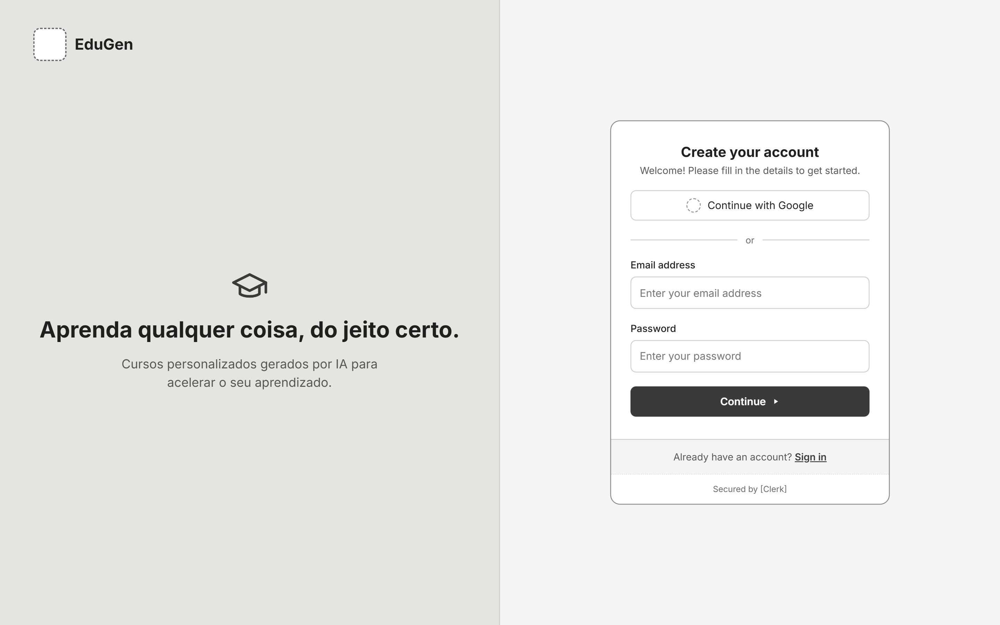
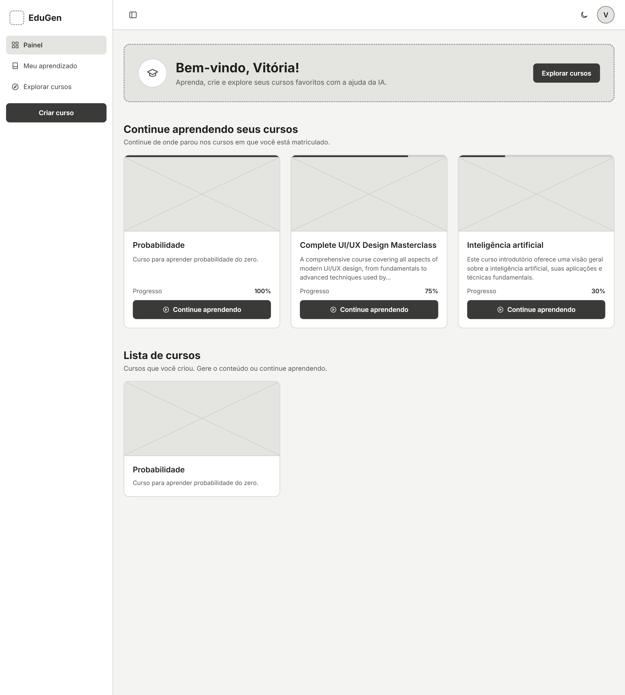
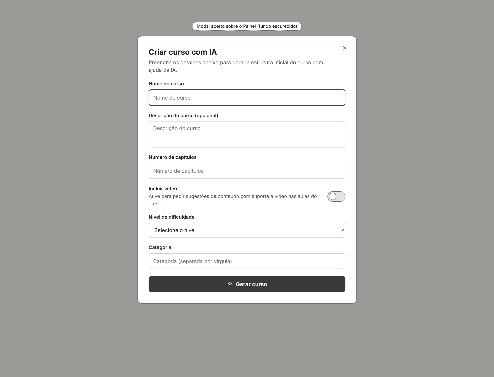
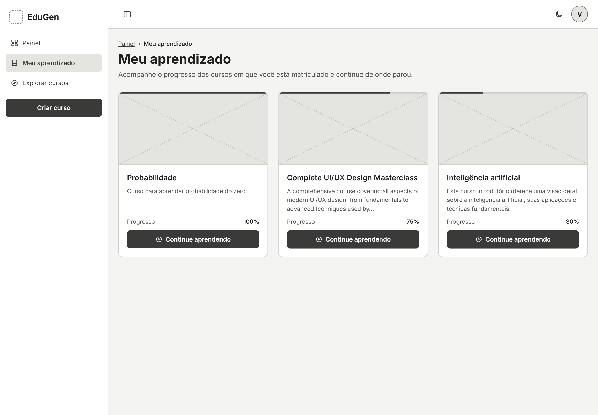

# Wireframes – EduGen

Wireframes das telas do EduGen, na ordem do fluxo de uso.

| # | Tela | Rota | Requisitos |
|---|---|---|---|
| 1 | [Landing page](#1-landing-page) | `/` | – |
| 2 | [Entrar](#2-entrar) | `/sign-in` | RF01 |
| 3 | [Criar conta](#3-criar-conta) | `/sign-up` | RF01 |
| 4 | [Painel](#4-painel) | `/workspace` | RF10 |
| 5 | [Criar curso com IA](#5-criar-curso-com-ia) | modal em `/workspace` | RF02, RF03, RF04 |
| 6 | [Detalhes do curso](#6-detalhes-do-curso) | `/workspace/view-course/[courseId]` | RF09, RF10 |
| 7 | [Explorar cursos](#7-explorar-cursos) | `/workspace/explore` | RF08, RF10 |
| 8 | [Meu aprendizado](#8-meu-aprendizado) | `/workspace/my-learning` | RF10 |
| 9 | [Aula](#9-aula) | `/course/[courseId]` | RF09 |

## 1. Landing page

## 2. Entrar

## 3. Criar conta

## 4. Painel

## 5. Criar curso com IA

## 6. Detalhes do curso

## 7. Explorar cursos

## 8. Meu aprendizado

## 9. Aula

